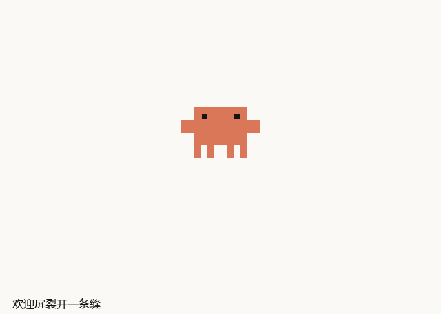
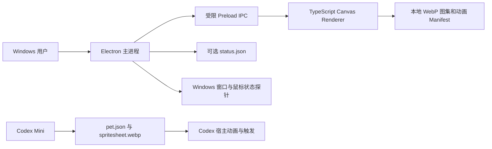

# Clawd（CLAWD）桌宠

**同一套 Claude / Clawd 衍生陶土像素身体，既是 Codex 本地宠物图集，也是拥有独立互动系统的 Windows 桌面小蟹。**

> **从欢迎屏跃出，住进你的桌面。**

Clawd 是本地 Claude / Clawd 粉丝作品，非 Anthropic 或 OpenAI 官方产品，未获其背书。仓库按用户要求公开可见；公开可见不代表获得再分发或商用许可。请先阅读 [LICENSE.md](LICENSE.md) 与[元素来源记录](docs/element-provenance.md)。

> **版本边界：**当前源码按 1.1.1 维护；公开版本、可下载资产和校验值以 [GitHub Releases](https://github.com/LYL-Z/clawd-desktop/releases) 为准。本仓库从 1.0.1 开始记录 Git 历史，不会把新源码伪标为 1.0.0；更早的 1.0.0 便携包不代表当前源码。

## 一、项目概览

Clawd 将用户提供的 Claude / Clawd 参考统一为一只陶土色像素小蟹，再交付到三个边界不同的载体：

| 载体 | 能力 | 边界 |
| --- | --- | --- |
| Windows 独立桌宠 | 透明置顶、鼠标交互、拖拽抛掷、衣柜、动作菜单、主题演出、动作剧场、本地状态桥、游戏/全屏场景隐藏和恢复、独立设置中心、手动检查与选择性下载 | 不接入云端模型，不自动读取 Codex/Claude 内部任务；游戏检测依赖用户配置的 EXE 规则；更新不会自动安装 |
| Codex 本地宠物 V2 | 九类基础状态的图集及 16 向注视素材 | 宿主控制状态与动作；不含 Windows 程序的衣柜、长按菜单、物理和四场演出 |
| 静态壁纸 | 浅色、深色各一张 3840×2160 PNG | 不含动态壁纸引擎，不自动更改系统背景 |

用户已确认 Codex Mini 显示 Clawd 且会动；互动与换装菜单属于独立 Windows 程序。项目定位是桌面陪伴应用与宿主专用素材包，不是通用动画框架、云平台或企业桌面管理服务。目标用户是希望在 Windows 或 Codex 中使用本地像素伙伴的个人用户。

**核心价值**以可交付内容衡量：28 个动作条目、8 套可选造型、4 场无声演出、16 向控制、两张 4K 壁纸。部分动作共享核心身体、服饰和物理编排，并非 28 套独立手绘角色。没有同行性能对比或效率提升数据，不作百分比承诺。

### 视觉预览

| 欢迎演出 | 柔软歪头 | 海报演出 |
| --- | --- | --- |
|  |  |  |

更多动作见[动作目录](docs/action-catalog.md)。

## 二、设计原则与技术取舍

1. **角色一致性：**所有造型叠加同一身体，动画与服饰分层注册，避免变成多个不相关角色。
2. **宿主边界清晰：**Codex 包只交付宿主可读的 pet 描述和图集，扩展交互放在独立桌宠中。
3. **本地优先：**状态和设置留在本机；没有遥测、模型 API 或账号服务。只有用户主动检查或下载更新时，才请求 Clawd 独立更新入口或 GitHub 的公开 Release 文件；请求不携带用户设置或应用规则。
4. **用户掌控：**原地、无声为默认；巡游、任务状态桥和开机启动需用户主动打开。
5. **安全边界明确：**Electron renderer 沙箱隔离，Preload 只暴露窄 IPC 接口。
6. **像素保真：**Canvas 禁用图像平滑，以确定性图集和锚点渲染。
7. **证据与声明一致：**Codex 状态、单机性能和设备覆盖范围均按实际测试范围陈述。

Electron 相比原生 UI 复用 Canvas 与本地逻辑，代价是约 100 MB 便携包；图集相比向量动画更贴合像素风格，但素材方向不代表任意角度连续插值；JSON 状态桥比私有插件 API 易审查，但要求用户主动写入。

## 三、架构与数据流

- **主进程**管理透明窗口、托盘、菜单、工作区、场景可见性仲裁、设置持久化、本地状态文件与用户主动触发的版本检查。
- **Preload** 通过 contextBridge 暴露白名单调用；renderer 没有 Node.js 访问权。
- **Renderer** 绘制像素图集，处理时间轴、动作、注视、菜单交互与演出。
- **shared** 模块实现帧选择、点击仲裁、方向索引、抛掷物理和状态验证。
- **原生探针**读取前台窗口几何与进程元数据，并按用户规则检测已配置的游戏；不读取屏幕内容、游戏内存或键盘文本。
- **Codex 包**不运行本项目代码；宿主读取宠物描述和 WebP 图集，决定实际播放。

无数据库、远程 API、分布式组件、插件协议或公开 SDK。

## 四、核心技术机制

图集 Manifest 将动作映射到素材、行列、帧数与持续时间。播放帧按累计时间选择：

    elapsed = (now - actionStart) modulo totalDuration
    frame = first frame whose cumulative duration is greater than elapsed

单次动作结束回到待机，循环动作保持；共用锚点映射到桌面坐标。拖动时进入 held，释放后从近期指针样本估算并限制速度，按显示器工作区推进，落地后回稳。减少动态会停止巡游、反弹、粒子和大型演出。

本地状态桥默认关闭，只接受用户写入的版本化 JSON。状态枚举为 idle、thinking、working、waiting、done、failed；文件上限 4 KiB，TTL 限于 1–300 秒，拒绝无效时间、过期事件和格式错误。细节去除控制字符并限制长度。系统不会通过猜测窗口、进程或终端来推断任务状态。

## 五、关键特性

| 特性 | 实现 | 场景与边界 |
| --- | --- | --- |
| 透明桌宠 | Electron 透明置顶窗口、透明区鼠标穿透 | Windows 本地陪伴；托盘可退出与恢复位置 |
| 互动 | 单/双击仲裁、长按菜单、拖拽抛掷、落地回弹 | 仅独立 Windows 程序提供 |
| 动作与衣柜 | 28 个动作条目、8 套可选造型、4 场无声演出 | 共用身体与道具编排；动作目录记录素材节拍 |
| 方向图集 | 16 向控制与动作剧场检查 | 少量中间角度警告仍保留 |
| Codex 宠物 | 九类基础状态和 16 向图集 | 只提供素材；状态触发由 Codex 宿主决定 |
| 任务桥 | 本地 JSON 文件与 PowerShell 写入器 | 手动演示，不是 Codex/Claude 自动集成 |
| 游戏与全屏场景 | 本地 Win32 探针、EXE 路径/文件名规则、可见性原因集合 | 智能、游戏运行期间、手动三种模式；未知场景不宣称已识别 |
| 设置中心 | 造型预览、启动选项、游戏/专注隐藏/例外规则、安静模式、行为频率、双击动作及诊断预览/导出 | 规则留在本机，显式操作后即时保存；导出前可检查预览 |
| 版本更新 | 用户点击后查询 Clawd 独立边缘入口，失败时回退 GitHub；可选分块断点下载 | 内置更新器下载 portable EXE 并校验 SHA-256，不自动安装；安装版请从 GitHub Release 获取 NSIS 安装向导 |
| 壁纸 | 浅/深 4K PNG | 用户自行设置为静态壁纸 |

状态桥示例：

    .\scripts\write-status.ps1 -State working -Detail '本地工作示例'
    .\scripts\write-status.ps1 -State done -Detail '本地任务完成'

当前没有面向第三方程序的桌宠控制 API、SDK 或插件 ABI。

## 六、技术栈

| 层级 | 版本 | 原因 |
| --- | --- | --- |
| TypeScript | 7.0.2 | 主进程、renderer 与共享逻辑的类型边界 |
| Electron | 44.7.2 | 透明窗口、托盘、系统事件；包体积是主要代价 |
| Canvas 2D / HTML / CSS | 浏览器内置 | 简单像素绘制，不引入 3D 或远程 UI 框架 |
| esbuild | 0.28.2 | 快速打包主进程、Preload 与 renderer |
| electron-builder | 26.15.3 | Windows x64 便携 EXE 与当前用户 NSIS 安装向导 |
| C# / .NET Framework v4 编译器 | Windows 构建机，自动探测常见编译器位置或通过 `CLAWD_CSC` 指定 | 窄范围 Win32 前台窗口和输入状态探针 |
| Playwright Core | 1.64.1（开发测试依赖） | Electron 桌面 QA，不作为运行时依赖 |
| Node test runner / Python unittest | 锁文件与系统运行时 | 共享逻辑与图像测量分类回归 |

完整依赖见 package.json 与 package-lock.json。运行发行包不需要 Node.js。Windows 源码构建需要 Node.js、npm、Python 3 与 Pillow（图标和图像测试）以及 .NET Framework C# 编译器或 Visual Studio Build Tools。构建脚本支持 `CLAWD_CSC` 覆盖编译器路径。

## 七、性能与测试证据

在一台 Windows x64 设备上约 182 秒空闲采样：平均 CPU 0.50%，进程树私有内存平均 239.2 MiB、峰值 244.9 MiB。该样本不是跨设备基准，不能证明小时级稳定或无内存泄漏；不同长度的旧采样不用于宣称性能提升比例。

仓库内的验收记录见[任务书完成度与验收记录](docs/taskbook-2.0-completion.md)。当前代码新增专注应用隐藏规则、安静模式、可配置双击、自主行为频率、显示器/DPI 环境变化处理、脱敏诊断预览与导出。自动化验证包括 Node 逻辑/服务测试、Python 图像测试、TypeScript 类型检查、Windows Electron/C# 构建、探针启动、软件 DPR/角色尺寸/服饰/动作布局 QA 与便携包启动。实际数量和 exact-SHA CI 结果以发布记录为准。2026-10-20，1.1.0 候选在单台 Windows x64 主机完成 1,800 秒普通模式采样（61 次样本，脚本判定通过）；同日长测实际运行 3,481.287 秒（约 58 分 1 秒）。用户于 2026-10-21 将 4 小时门槛改为沿用此前约 1 小时观察。最终 1.1.1 包另有 6,482 秒中断观察，最后保存样本窗口响应、桌面可见、探针在线；没有完整报告或 `passed` 结论。见[稳定性记录](docs/qa/2026-10-21-v1.1.1-windows-stability.md)。真实游戏、物理多屏/混合 DPI/热插拔、焦点、锁屏/恢复及跨设备稳定性仍需目标环境验收。

## 八、快速开始

源码运行（Windows x64）：

    npm ci
    npm run check
    npm test
    python -m unittest discover -s tests
    npm start

npm start 会先构建再运行；npm run studio 打开动作剧场。首次安装依赖需联网，程序运行素材与状态留在本地。

## 九、安装与更新

本项目提供 Windows x64 **便携版 EXE** 和**当前用户 NSIS 安装向导**。安装向导会创建开始菜单快捷方式和 Windows 卸载项，不要求管理员权限，并沿用 `%APPDATA%\Clawd` 用户数据目录。设置中心“隐私与关于”可手动查询最新正式 Release；内置更新器提供的仍是便携版 EXE，下载通过 SHA-256 校验后由用户手动运行，不会自动安装或替换程序。若要保持安装版，请从 GitHub Release 下载对应的 NSIS 安装向导。程序和安装向导未签名，Windows 可能提示未知发布者；请核对 Release 中的哈希，不要为此关闭系统保护。版本和发布资产以 [GitHub Releases](https://github.com/LYL-Z/clawd-desktop/releases/latest) 为准。

1.1.0 使用 Clawd 自定义子域并以 GitHub 为备用源；1.1.1 已正式发布，更新入口切换到 Clawd 专属 `workers.dev` 域名，避免更改 `chronokalamos.com` 的区域级 TLS 设置。GitHub Release 始终是唯一正式版本和安装文件来源；1.1.1 同时提供便携 EXE 和当前用户 NSIS 安装向导，内置更新器仍只分发便携版。没有修改区域级 TLS/DNS/路由，也未改动九霄或 GlassDesk。Cloudflare Workers 为用户报告的 Free，但账户账单与余量没有通过 Billing API 独立核实。普通全球边缘入口不能保证中国大陆所有运营商和网络时段始终可达；China Network 不属于本版本范围。详见[更新分发设计](docs/update-delivery.md)。

Codex V2 包为 Clawd-Codex-V2.zip。可在 Codex 宠物设置中手动选择，也可在 Windows 运行本地复制脚本：

    powershell -NoProfile -File .\scripts\install-pet.ps1

脚本会校验宠物包，并备份同名旧目录；它不会替用户改变当前选择。安装细节见[两个版本怎么用](docs/两个版本怎么用.md)。没有云同步、自动下载/安装、灰度升级、迁移工具、Docker 或 Kubernetes 部署。

1.0.0 便携 EXE 是当前源码之前的历史构建，文件名仍保留版本号并随 1.0.1 Release 明确标注。未捕获其独立源码快照，因此仓库不提供虚假的 1.0.0 源码 Tag。

## 十、使用指南与配置

| 操作 | 效果 |
| --- | --- |
| 单击角色 | 挥手 |
| 双击角色 | 默认海报演出；可改为挥手、歪头或无特殊动作 |
| 长按角色 | 动作菜单 |
| 拖拽后松手 | 抛掷与落地回稳 |
| 右键角色 | 设置和衣柜 |
| 托盘菜单 | 退出、减少动态、安静模式、收回当前屏幕、可选功能 |

原地与无声为默认。智能模式下，已配置游戏、专注隐藏应用的前台窗口和启用的全屏规则会使 Clawd 隐藏；离开后延迟恢复。游戏运行期间模式会在配置的游戏进程仍运行时保持隐藏。锁屏和系统挂起始终隐藏。安静模式保持位置并降低自主动作频率；仍允许用户手动互动。沿边巡游、任务桥、游戏规则和开机启动由用户主动配置。Codex 菜单与衣柜不是本项目可以安装到宿主中的功能。

## 十一、安全、隐私与威胁模型

- Electron 使用 contextIsolation=true、nodeIntegration=false、sandbox=true；主进程验证 IPC 来源。
- Renderer 默认会拦截非本地资源请求；无遥测、模型 API 或账号。只有用户主动检查或选择下载时，主进程才连接固定的 Clawd 更新子域与 GitHub 公共 Releases 资产地址。请求不包含设置与应用规则；更新下载完成后先校验 SHA-256，不会自动执行文件。
- 不读取终端、窗口标题、屏幕、剪贴板、键盘文本或用户文件。探针限于前台窗口几何/全屏和左键状态。
- 状态文件经过大小、字段、枚举、时间和 TTL 校验；错误或过期输入被丢弃。
- 本地风险包括未签名 EXE、用户本地文件篡改和依赖供应链问题。没有代码签名、SBOM、持续漏洞扫描、独立审计或响应 SLA。
- 这是公开可见的非官方粉丝项目，素材权利未知处保持未知；公开仓库可按 GitHub 服务条款查看和 fork，但不提供通用开源或商用许可。

## 十二、故障排查

| 现象 | 说明 |
| --- | --- |
| Codex 里没有换装/互动菜单 | 宿主包只有图集；请运行独立 Windows 桌宠 |
| Clawd 没有按游戏规则隐藏 | 确认设置中心已添加实际游戏 EXE、规则已启用，并查看前台/游戏运行模式；全屏规则和游戏规则彼此独立 |
| Clawd 没有在指定办公应用前隐藏 | 为该应用添加“专注时隐藏”规则；只在智能模式匹配前台 EXE |
| 自主动作过于频繁 | 设置中心调低自主频率或启用安静模式；手动互动仍可使用 |
| 需要协助诊断 | 设置 > 隐私与关于 > 先查看诊断预览，再决定是否导出；分享前请再次检查 JSON |
| 自动场景检测不可用 | Windows 原生探针未启动或无心跳；Clawd 仍可手动使用，尝试重启程序或切换手动模式 |
| 游戏切回桌面后桌宠不恢复 | 游戏运行期间模式会持续隐藏，直到配置的游戏进程退出；智能模式按恢复延迟显示 |
| 版本检查失败 | 检查网络连接；边缘入口与 GitHub 备用源都不可用或尚无正式 Release 时可稍后重试，也可手动打开 Release 页面 |
| 更新下载中断 | 再次点击下载可从本机 `.part` 文件继续；完成后必须通过 SHA-256 校验，之后手动关闭旧程序并运行新文件 |
| Codex 预览正确，Mini 未更新 | 先确认宿主当前读取状态；项目不清理 Codex 缓存或修改宿主内部文件 |
| 桌宠无法点击 | 透明空白区域会穿透；检查是否位于角色实体区域 |
| 桌宠离屏 | 在托盘选择“收回当前屏幕” |
| 任务状态没变化 | 状态桥默认关闭，需用户开启并写入有效且未过期的 JSON |
| Windows 提示未知发布者 | 程序未签名；只从本项目 Release 下载并核对哈希 |

目前没有稳定的公开错误码体系。架构审计与场景协议见[审计报告](docs/architecture-audit.md)和[可见性设计](docs/visibility-and-scenes.md)。

## 十三、治理与路线图

当前为个人维护的公开可见项目，无外部贡献者等级、公开支持 SLA、社区会议或赞助渠道。PR #16 的精确 SHA Windows CI 和合并后 `main` CI 均通过。用户报告 15 项目标设备验收通过；本项目未独立收集逐项设备记录。1.1.0 已正式发布，1.1.1 发布状态与下载附件以 [GitHub Releases](https://github.com/LYL-Z/clawd-desktop/releases) 为准。仓库没有通用开源或再分发许可；GitHub 上查看与 fork 受 GitHub 服务条款约束，其他用途未获授权。

## 十四、架构决策记录（ADR）

| 决策 | 选择与原因 | 取舍 |
| --- | --- | --- |
| 桌面框架 | Electron，复用 Canvas 和窗口能力 | 便携包约 100 MB |
| 动画表达 | 共享身体 + 数据驱动图集 | 身份稳定；非每个动作独立绘制 |
| Codex 适配 | 宠物图集与 Windows 程序分开 | 诚实遵循宿主边界；两载体功能不相同 |
| 任务状态 | 默认关闭的本地 JSON 文件协议 | 易校验且不依赖私有 API；需用户主动写入 |
| 系统场景 | 进程元数据、用户规则与可见性原因仲裁 | 游戏识别透明且可配置；未列入规则的窗口化游戏不会被可靠识别 |
| 版本更新 | 用户主动检查、选择分块续传；Clawd Worker 优先、GitHub 备用；SHA-256 校验后手动替换 | 平时保持离线；不自动安装；依赖免费边缘平台配额与 GitHub 源可用性，不能承诺中国网络全线可达 |
| 发布形态 | 未签名 portable EXE 与当前用户 NSIS 安装向导 | 安装向导支持标准卸载；签名信任仍未覆盖 |

## 十五、生态、案例与局限

只维护 Windows 桌宠、Codex 本地宠物包与静态壁纸；没有容器镜像、Helm、第三方插件或 SDK。Clawd 更新 Worker 已部署到专属 `workers.dev` 与兼容域名；上线范围和公网证据见[更新分发说明](docs/update-delivery.md)。用户报告目标设备 15 项场景验收通过，但没有逐项记录；长稳观察按 2026-10-21 的用户指示采用先前约 1 小时记录，具体时长、版本和边界见[稳定性记录](docs/qa/2026-10-21-v1.1.1-windows-stability.md)。尚无企业生产案例。Windows x64 开发机和一次 Codex Mini 使用体验不能代表所有设备或宿主版本。

## 十六、许可证与致谢

LICENSE.md 当前标记为 UNLICENSED：程序与编排文件仅供本次委托用户本地使用和修改，整包未获公开再分发或商业使用许可。Claude / Clawd 名称、参考图和衍生视觉仍受相关权利边界约束。Electron 等运行依赖许可证随发行包保留，开发依赖依上游许可。

感谢用户提供 Claude / Clawd 参考，并指出喜欢的柔软歪头姿态。项目没有外部贡献者、赞助商或官方背书。

---

**资源：**[Releases](https://github.com/LYL-Z/clawd-desktop/releases/latest) · [更新日志](CHANGELOG.md) · [1.1.1 版本说明](docs/RELEASE-NOTES-v1.1.1.md) · [1.1.0 版本说明](docs/RELEASE-NOTES-v1.1.0.md) · [1.0.1 版本说明](docs/RELEASE-NOTES-v1.0.1.md) · [1.0.0 历史二进制说明](docs/RELEASE-NOTES-v1.0.0.md) · [逐版本发布清单](docs/RELEASE-CHECKLIST.md) · [动作目录](docs/action-catalog.md) · [场景架构审计](docs/architecture-audit.md) · [来源记录](docs/element-provenance.md) · 历史包校验清单：`SHA256SUMS.txt`
